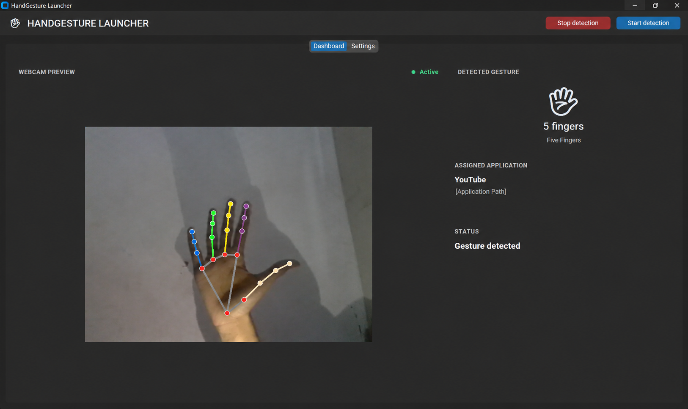
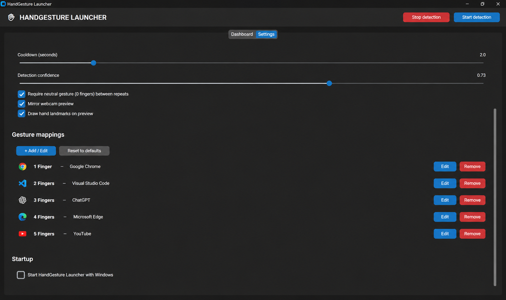

# ✋ HandGesture Launcher

### Control Your Windows PC Using Hand Gestures

A Python-based Windows desktop application that uses real-time computer vision and hand gesture recognition to launch, minimise, and restore applications using simple hand gestures.

Instead of manually opening applications, simply show a gesture to your webcam and let HandGesture Launcher do the work.


---

## 📸 Application Screenshots

### Dashboard Overview


### Real-Time Hand Gesture Detection


### Application Settings


### Gesture Mapping Configuration


---

## 1. Project Overview

HandGesture Launcher is a desktop automation application that allows users to control Windows applications through hand gestures detected using a webcam.

The application uses:
- **MediaPipe** for hand landmark detection.
- **OpenCV** for webcam access and image processing.
- **CustomTkinter** for the graphical user interface.

The system detects finger positions, recognises gestures, and performs the corresponding actions.

It also provides gesture stabilisation, cooldown management, custom application mappings, and configuration persistence.

The application is not restricted to predefined programs. Users can customise which applications are assigned to each gesture.

## 2. Key Features

- Real-time hand detection using a webcam.
- Finger counting from 0 to 5.
- Gesture-based application launching.
- Customisable gesture-to-application mappings.
- Gesture stability detection to prevent accidental launches.
- Cooldown mechanism to prevent repeated launches.
- Fist gesture to minimise the last launched application.
- Rock On gesture to restore the last minimised application.
- Custom desktop interface using CustomTkinter.
- JSON-based configuration persistence.
- Adjustable gesture sensitivity settings.
- Windows startup integration.
- Automated testing using Pytest.

## 3. Gesture Controls

| Hand Gesture | Action |
|---|---|
| ☝️ 1 Finger | Launch assigned application |
| ✌️ 2 Fingers | Launch assigned application |
| 3 Fingers | Launch assigned application |
| 4 Fingers | Launch assigned application |
| 🖐️ 5 Fingers | Launch assigned application |
| ✊ Closed Fist | Minimise last launched application |
| 🤘 Rock On | Restore last minimised application |

**Note:** Application mappings can be customised through the Settings interface.

## 4. Technologies Used

| Technology | Purpose |
|---|---|
| Python 3.12 | Core programming language |
| OpenCV | Webcam access and image processing |
| MediaPipe | Hand landmark detection |
| CustomTkinter | Desktop graphical interface |
| JSON | Configuration storage |
| Pytest | Automated testing |
| PyInstaller | Windows executable generation |

## 5. Requirements

- Windows 10 or Windows 11.
- Python 3.12.
- Working webcam.
- Git.
- Required Python dependencies.

## 6. Installation

### Step 1: Clone the repository

```bash
git clone https://github.com/anubhavchaudhary609-lgtm/HandGesture-Launcher.git
```

### Step 2: Navigate to the project directory

```bash
cd HandGesture-Launcher
```

### Step 3: Create a virtual environment

```bash
python -m venv .venv
```

### Step 4: Activate the environment

```powershell
.venv\Scripts\Activate.ps1
```

### Step 5: Install dependencies

```bash
pip install -r requirements.txt
```

## 7. Running the Application

Start the application:

```bash
python main.py
```

### How to Use

1. Launch HandGesture Launcher.
2. Open the Dashboard.
3. Click **Start Detection**.
4. Allow webcam access.
5. Show your hand in front of the camera.
6. Raise the desired number of fingers.
7. Hold the gesture until it becomes stable.
8. The assigned application launches automatically.

Use the closed-fist gesture to minimise the last launched application and the Rock On gesture to restore it.

## 8. Gesture Mapping

Users can assign different applications to different finger-count gestures.

Navigate to:

**Settings → Gesture Mappings**

Example configuration:

| Gesture | Assigned Application |
|---|---|
| 1 Finger | Google Chrome |
| 2 Fingers | Visual Studio Code |
| 3 Fingers | Spotify |
| 4 Fingers | WhatsApp |
| 5 Fingers | Calculator |

These are example mappings and can be customised.

### Available Operations

- Add a new application.
- Edit an existing mapping.
- Remove an application.
- Browse for executable files.
- Reset mappings to defaults.

Supported application paths include `.exe`, `.lnk`, `.bat`, and `.cmd` files.

### Configuration Storage

Application mappings are stored locally:

```text
%APPDATA%\HandGestureLauncher\config.json
```

## 9. Gesture Sensitivity Settings

Users can customise gesture recognition through the Settings interface.

| Setting | Description |
|---|---|
| Stability (Frames) | Consecutive frames required to confirm a gesture |
| Cooldown (Seconds) | Minimum interval between application launches |
| Detection Confidence | Minimum confidence threshold for hand detection |
| Require Neutral Gesture | Requires a neutral gesture between repeated launches |
| Mirror Webcam Preview | Mirrors the webcam preview |
| Draw Hand Landmarks | Displays detected hand landmarks |

These settings help improve recognition reliability and reduce accidental launches.

## 10. Start with Windows

The application provides a Windows startup option.

Navigate to:

**Settings → Startup**

Enable:

**Start HandGesture Launcher with Windows**

The application registers a per-user startup entry in the Windows Registry.

Registry location:

```text
HKEY_CURRENT_USER\Software\Microsoft\Windows\CurrentVersion\Run
```

No administrator privileges are required for this per-user registration.

## 11. Project Architecture

The project follows a modular architecture in which different components handle camera operations, gesture recognition, application launching, configuration management, and the graphical interface.

| Module | Responsibility |
|---|---|
| camera.py | Webcam access and device discovery |
| gesture_detector.py | Hand detection and finger counting |
| gesture_manager.py | Gesture stability and cooldown management |
| app_launcher.py | Application launching, minimising and restoring |
| config_manager.py | JSON configuration management |
| startup_manager.py | Windows startup integration |
| gui/app.py | Main application window |
| gui/dashboard.py | Dashboard and webcam preview |
| gui/settings.py | Application settings and mappings |
| gui/application_dialog.py | Add/Edit application dialog |

## 12. Project Structure

```text
HandGestureLauncher/
│
├── main.py
├── build.py
├── requirements.txt
├── pytest.ini
├── README.md
│
├── assets/
│   └── screenshots/
│       ├── dashboard-overview.png
│       ├── gesture-detection.png
│       ├── settings.png
│       └── gesture-mapping.png
│
├── config/
│
├── src/
│   ├── camera.py
│   ├── gesture_detector.py
│   ├── gesture_manager.py
│   ├── app_launcher.py
│   ├── config_manager.py
│   ├── startup_manager.py
│   │
│   └── gui/
│       ├── app.py
│       ├── dashboard.py
│       ├── settings.py
│       └── application_dialog.py
│
└── tests/
    ├── test_app_launcher.py
    ├── test_config_manager.py
    ├── test_gesture_detector.py
    └── test_gesture_manager.py
```

## 13. Running Tests

The project includes automated tests covering its core functionality.

Tests cover:

- Application launching.
- Configuration management.
- Gesture detection.
- Gesture management.

Run the test suite:

```bash
python -m pytest -q
```

**Latest test results: 23 passed.**

The core logic tests do not require an active webcam.

## 14. Building a Windows Executable

The project includes a build script for generating a standalone Windows executable using PyInstaller.

Run:

```bash
pip install -r requirements.txt
python build.py
```

The generated executable is expected at:

```text
dist/HandGestureLauncher.exe
```

The executable should be tested on a clean Windows environment before distribution.

## 15. Troubleshooting

| Problem | Possible Solution |
|---|---|
| Webcam cannot be opened | Close other applications using the camera and check Windows camera permissions |
| Slow detection | Adjust detection confidence and camera resolution |
| Incorrect finger count | Improve lighting and keep your palm clearly visible |
| Repeated application launches | Increase stability frames or cooldown duration |
| Application not found | Update the application path through Settings |
| Multiple hands detected | Show only one hand clearly to the webcam |

## 16. Privacy and Security

- Webcam frames are processed locally on the user's machine.
- No webcam footage is intentionally uploaded to an external server.
- Application mappings are stored locally.
- Users select which applications they want to launch.
- Configuration is maintained within the user's Windows profile.

## 17. Future Improvements

Potential future enhancements include:

- Support for additional hand gestures.
- Custom gesture creation.
- Improved gesture recognition accuracy.
- More desktop automation controls.
- Enhanced application customisation.
- Additional accessibility features.

---

## 👨‍💻 Developer

**Anubhav Chaudhary**

B.Tech Computer Science Student

Developed as an independent Python desktop application project.

---

⭐ If you find this project interesting, consider starring the repository!

**GitHub Repository:**

https://github.com/anubhavchaudhary609-lgtm/HandGesture-Launcher