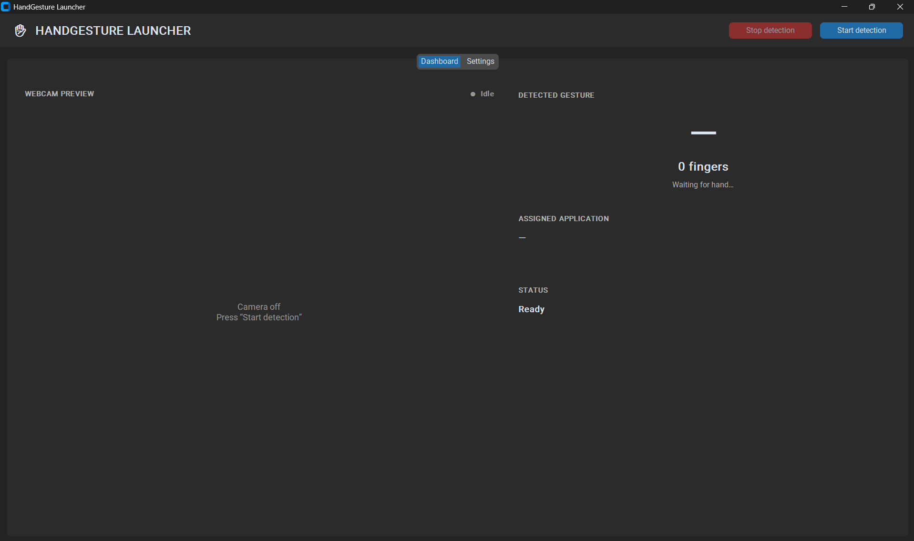
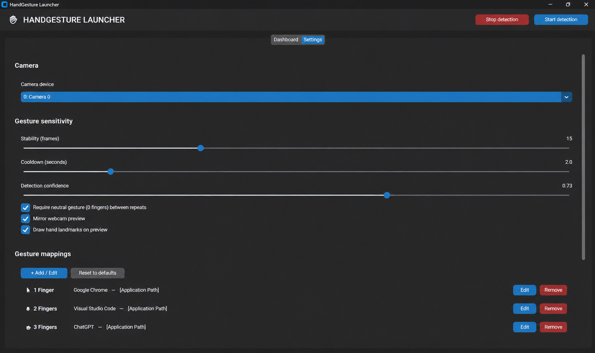

# HandGesture Launcher

Control your Windows PC with your hand.
HandGesture Launcher uses your webcam to count how many fingers you are raising and launches any application **you choose** for each finger count (1‑5). Everything is configurable, everything runs locally, and no video ever leaves your computer.

## Application Screenshots

### Dashboard Overview


### Real-Time Gesture Detection


### Application Settings


---

## 1. What it does

* Watches a live webcam feed.
* Detects one hand and counts extended fingers (0‑5) using MediaPipe.
* Waits until the gesture is *stable* for a configurable number of frames.
* Launches the application you have assigned to that finger count.
* Enforces a cooldown so the same app is not spammed while you keep your hand up.
* Lets you edit / add / remove / reset gesture-to-application mappings in a friendly GUI.

The launcher is *not* hard‑coded to Chrome, Spotify, etc. – those are only example defaults you can change at any time.

---

## 2. Requirements

* **Windows 10 or 11** (Linux/macOS also work for development, but the Windows‑startup registration is Windows-only).
* **Python 3.10 or 3.11** (MediaPipe currently does not ship wheels for Python 3.12+).
* A working webcam.

---

## 3. Installation

```bat
git clone <your-repo-url> HandGestureLauncher
cd HandGestureLauncher

python -m venv .venv
.venv\Scripts\activate

pip install -r requirements.txt
```

---

## 4. Running the application

```bat
python main.py
```

The main window opens on the **Dashboard** tab:

```
┌─────────────────────────────────────────────────────────┐
│           ✋ HANDGESTURE LAUNCHER                        │
├───────────────────────────┬─────────────────────────────┤
│                           │  DETECTED GESTURE           │
│      WEBCAM PREVIEW       │        🤟                   │
│                           │   3 fingers                 │
│                           │                             │
│                           │  Assigned application:      │
│                           │   Spotify                   │
│                           │                             │
│                           │  Status: Ready              │
├───────────────────────────┴─────────────────────────────┤
│  [Start detection]  [Stop detection]                    │
└─────────────────────────────────────────────────────────┘
```

1. Click **Start detection**.
2. Allow the app to use your webcam.
3. Raise a chosen number of fingers (1‑5).
4. Hold that pose for a moment – the app confirms and launches your program.

---

## 5. Assigning applications to gestures

Open the **Settings** tab → *Gesture mappings*.

Each row shows the current mapping:

```
☝  1 Finger   Google Chrome   —   C:\...\chrome.exe    [Edit] [Remove]
✌  2 Fingers  Visual Studio Code   —   ...             [Edit] [Remove]
🤟 3 Fingers  Spotify   —   ...                        [Edit] [Remove]
🖖 4 Fingers  WhatsApp   —   ...                       [Edit] [Remove]
🖐 5 Fingers  Calculator   —   ...                     [Edit] [Remove]
```

Click **Edit** or **+ Add / Edit**, then use **Browse…** to pick any `.exe`, `.lnk`, `.bat` or `.cmd` file on your machine. The path is validated before saving; you get a clear error if the file cannot be found.

Click **Reset to defaults** to restore the example mappings.

Mappings are stored as JSON at:

```
%APPDATA%\HandGestureLauncher\config.json     (Windows)
~/.handgesture_launcher/config.json           (Linux / macOS)
```

---

## 6. Sensitivity settings

Under **Settings → Gesture sensitivity** you can tune:

| Setting | What it does |
|---|---|
| Stability (frames) | How many consecutive frames the same gesture must appear before it fires. Higher = fewer accidental launches, slower response. |
| Cooldown (seconds) | Minimum time between two launches. |
| Detection confidence | MediaPipe threshold for considering a hand detected. |
| Require neutral gesture (0 fingers) between repeats | If enabled, you have to close your fist between two identical launches. |
| Mirror webcam preview | Mirrors the preview so your hand moves the way you expect. |
| Draw hand landmarks on preview | Overlay MediaPipe skeleton on the video. |

Every change is applied to the running detector immediately – no restart required.

---

## 7. Start with Windows

Under **Settings → Startup** you can tick **Start HandGesture Launcher with Windows**. This adds a per-user entry under
`HKEY_CURRENT_USER\Software\Microsoft\Windows\CurrentVersion\Run` (no admin rights required). Uncheck the box to remove it.

---

## 8. Troubleshooting

| Symptom | Fix |
|---|---|
| "Could not open the webcam" | Close other apps using the camera (Zoom, Teams, browser tabs). In Windows privacy settings allow desktop apps to access the camera. |
| App is very slow / high CPU | Reduce **Detection confidence** to 0.5, or lower the camera resolution in `config.json`. |
| Wrong finger count | Move closer to the camera, improve lighting, keep hand palm-forward, mirror preview on. |
| Application launches over and over | Increase **Stability (frames)** and **Cooldown**, or enable **Require neutral gesture**. |
| "Application not found" | The `.exe` moved or is not installed. Update the path via *Settings → Edit*. |
| Multiple hands warning | Only show one hand to the camera – the launcher picks the largest hand but pauses on ambiguity. |

Logs are printed to the terminal (or to stderr when packaged with `--windowed`).

---

## 9. Building a Windows executable

You only need to do this once, on a Windows machine:

```bat
pip install -r requirements.txt
python build.py
```

This runs PyInstaller with the correct MediaPipe / CustomTkinter data bundling and produces:

```
dist\HandGestureLauncher.exe
```

Double-click it – no Python installation required for the user.

If you place `assets\icon.ico` in the project the build script will use it as the application icon.

---

## 10. Running the tests

Pure-logic unit tests (finger counting, stability, cooldown, config persistence, launcher error handling) run without a webcam or a GUI:

```bat
python -m pytest -q
```

---

## 11. Project layout

```
HandGestureLauncher/
├── main.py                 # entry point
├── build.py                # PyInstaller build script
├── requirements.txt
├── src/
│   ├── camera.py           # OpenCV camera wrapper + device discovery
│   ├── gesture_detector.py # MediaPipe wrapper + finger counting + extensible engine
│   ├── gesture_manager.py  # Stability window + cooldown + neutral reset
│   ├── app_launcher.py     # Cross-platform executable launcher
│   ├── config_manager.py   # JSON persistence (%APPDATA%\HandGestureLauncher)
│   ├── startup_manager.py  # Windows Registry autostart integration
│   └── gui/
│       ├── app.py                 # Main CustomTkinter window + worker thread
│       ├── dashboard.py           # Live preview + detected-gesture panel
│       ├── settings.py            # Camera / sensitivity / mappings / startup UI
│       └── application_dialog.py  # Add/Edit application dialog
├── tests/                  # pytest suite (pure-logic, no camera)
├── assets/                 # icons, screenshots, optional icon.ico
└── config/
```

---

## 12. Extending the gesture engine

`src/gesture_detector.py` exposes a small `GestureEngine` with an ordered list of *rules*. Each rule receives the `HandLandmarks` and returns either a gesture name (like `"thumbs_up"`) or `None`. To add a new gesture:

```python
def thumbs_up_rule(hand):
    ...  # your geometry check
    return "thumbs_up" if condition else None

engine = GestureEngine(rules=[thumbs_up_rule, finger_count_rule])
```

The rest of the app (stability, cooldown, launching) works with any gesture name – finger counts are only the default set that the mapping UI is built around today.

---

## 13. Privacy & security

* Webcam frames are processed **entirely on your machine**. Nothing is uploaded, logged or transmitted.
* The launcher only runs paths **you** explicitly picked in Settings. It refuses to run missing files or non-file paths.
* Configuration is stored under your user profile only – no system-wide writes are performed.

---

Happy launching! ✋
